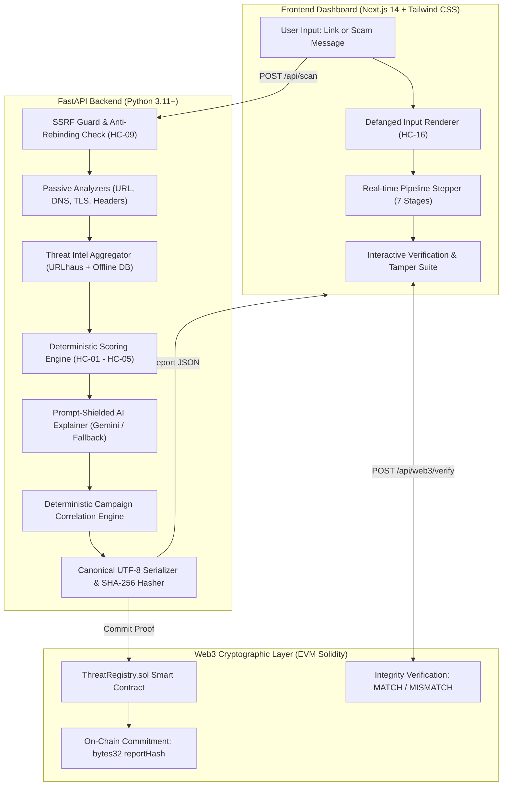

# TrustTrace: Link & Scam Detective
**AI-Powered Web Threat Detection & Digital Trust Intelligence**  
*HackMatrix 2026 — Team APEX WARCODE (`HM-6FC44F`)*  
*Team Members: Somnath Pal (Leader), Sreya Roy, Sudhansu Kumar, Sukriti Singh*  
*Domains: AI · Cybersecurity · Web3*

---

## 1. Executive Summary & Elevator Pitch
**TrustTrace (Link & Scam Detective)** is a dual-input security analysis platform that evaluates suspicious links and scam messages using multi-layer heuristics, DNS and RDAP telemetry, TLS certificate inspection, and authoritative threat intelligence. The system employs prompt injection-defended AI to synthesize plain-English explanations without hallucinated verdicts, and cryptographically anchors every report onto an EVM smart contract for tamper-evident verification while maintaining strict off-chain privacy. Built for HackMatrix 2026 by team **APEX WARCODE**, TrustTrace delivers transparent, explainable, and provable cyber defense for the modern web.

---

## 2. Architecture & System Flow



---

## 3. The 16 Hard Constraints Compliance Matrix

TrustTrace strictly satisfies every single hard constraint mandated by the HackMatrix 2026 specification:

| Constraint | Requirement | TrustTrace Implementation & Proof |
| :--- | :--- | :--- |
| **HC-01** | Exact 5 risk labels | Only `Low Risk`, `Suspicious`, `High Risk`, `Confirmed Malicious`, `Inconclusive` can ever be output. |
| **HC-02** | Banned verdict words | Never uses "safe", "100% safe", "guaranteed safe" in verdicts or explanations. Verified by automated post-generation regex filters. |
| **HC-03** | HTTPS never lowers risk | Valid TLS certificate adds 0 trust points. Lookalike bank domains with valid certificates remain capped at `Suspicious` or `High Risk`. |
| **HC-04** | Absence of threat match ≠ safe | Sites with zero threat hits but insufficient evidence coverage are labeled `Inconclusive`. |
| **HC-05** | Confirmed Malicious threshold | Assigned **only** when an authoritative threat feed (URLhaus / Curated Threat Intel) matches the exact URL or host; heuristics alone cannot trigger it. |
| **HC-06** | Urgent language alone ≠ fraud | Urgent SMS text alone is capped at `Suspicious`. `High Risk` requires corroborating technical signals (suspicious links, credential lures). |
| **HC-07** | Strict Off-Chain Privacy | Zero raw URLs, raw message text, or user PII ever written to the blockchain. |
| **HC-08** | Minimal On-Chain Payload | Smart contract stores only 32-byte report hash, timestamp, reporter address, revision counter, and status enum. |
| **HC-09** | Multi-Layer SSRF Guard | Validates every redirect hop. Blocks loopback (127.0.0.1, ::1), RFC 1918 private ranges, AWS/GCP cloud metadata (169.254.169.254), CGNAT, numeric IP disguises (decimal, octal, hex), and binds directly to validated IPs to prevent DNS rebinding. |
| **HC-10** | Passive Inspection Only | Never executes JavaScript, never downloads files, caps response bodies to 200 KB, and enforces 4s connect, 10s request, and 25s overall deadlines. Inspects only destination, `/robots.txt`, and `/.well-known/security.txt`. |
| **HC-11** | Explainable AI Grounding | AI summary is enclosed in per-request random boundary markers (`<<<BOUNDARY_xyz>>>`). AI cannot change the risk label and is constrained strictly to citing provided technical finding IDs. |
| **HC-12** | eMudhra Distrust Guardrail | Checks presented certificate chains against published CA distrust lists by SHA-256 fingerprint (TLS-06). Never falsely claims to detect internal CA key generation flaws from a public URL. |
| **HC-13** | Sensitive Token Redaction | Redacts credit card numbers (Luhn-checked), Indian Aadhaar numbers, OTP codes, and private keys before persistence or AI inference. |
| **HC-14** | Non-Intrusive Fetching | Requests are strictly non-intrusive (no form submissions, no vulnerability scans, no fuzzing). |
| **HC-15** | Secrets Management | All API keys and private keys reside in backend environment variables (`.env`), never exposed to client or committed to git. |
| **HC-16** | Defanged Link Rendering | UI strictly defangs untrusted URLs (`hxxp://`, `[.]`), renders them as inert text (never clickable `<a href>`), and forbids HTML injection. |

---

## 4. Multi-Stage Analysis Pipeline

### 4.1 Input Normalization & SSRF Defense
- Strips leading/trailing whitespace, tabs, and zero-width characters.
- Parses host and port (restricts to standard web ports 80, 443, 8080, 8443).
- Resolves DNS and inspects every resolved IP against blacklisted CIDRs (Loopback, Link-Local, Cloud Metadata, CGNAT, Class E, IPv6 mapped).
- Employs **direct socket connection to validated IP** with Host SNI header to defeat Time-of-Check to Time-of-Use (TOCTOU) DNS rebinding.

### 4.2 Lexical & Structural Detection
- **Punycode & Confusables (IMP-04)**: Detects internationalized domain names (IDNs) mimicking ASCII brands (e.g. `xn--gogl-qqa.com`).
- **Brand Lookalikes (IMP-01 / STR-01)**: Matches high-value brands (State Bank of India, HDFC, ICICI, PayPal, Google, Microsoft, Amazon) combined with phishing keywords (`login`, `verify`, `kyc`, `pan`, `account`, `security`).
- **Official Domain Allow-List (MIT-01)**: Grants mitigation when domain matches verified official root domains (e.g. `sbi.co.in`, `github.com`).
- **URL Shorteners & Embedded Redirects (STR-06 / STR-07)**: Detects link disguises (`bit.ly`, `tinyurl.com`) and open redirect parameters (`?redirect=`, `?url=`).

### 4.3 Passive Network, TLS & Security Headers
- **Dual TLS Handshake**: Performs strict certificate validation against system trust store, followed by a permissive diagnostic handshake to extract full X.509 metadata even from expired or untrusted servers.
- **Certificate Transparency (CT) Logging**: Queries public CT logs via crt.sh to assess domain certificate issuance velocity.
- **Distrusted CA Verification (TLS-06)**: Validates intermediate and root certificate SHA-256 fingerprints against Google Chrome and Mozilla distrust lists.
- **HTTP Security Headers**: Inspects `Strict-Transport-Security` (HSTS), `Content-Security-Policy` (CSP), `X-Frame-Options`, `X-Content-Type-Options`, and `Referrer-Policy`.

### 4.4 Threat Intelligence
- **URLhaus API (`abuse.ch`)**: Queries live malicious URL feed with 5s timeout.
- **Curated Offline Threat Database**: Bundled fallback threat repository covering banking phishing, malware drops, and ransomware infrastructure.
- **Decision Rule**: Match on online or offline threat intel immediately triggers `Confirmed Malicious` (INT-01) and short-circuits outbound HTTP fetching.

### 4.5 Scam Message Analysis
- Extracts embedded URLs, Indian phone numbers (`+91`), and UPI IDs (`name@bank`).
- Evaluates 8 scam signals: Urgent threat (MSG-01), Account suspension (MSG-02), Financial loss/gain (MSG-03), Sensitive credential lure (MSG-04), Unofficial domain link (MSG-05), UPI request lure (MSG-06), OTP lure (MSG-07), and Contact bypass (MSG-08).
- **Negation Guards**: Disregards urgency when legitimate educational contexts are detected (e.g., *"We will never ask for your password or OTP"*).

### 4.6 Grounded AI Explanation
- Leverages Google Gemini 1.5 / 2.0 API with fallback to a deterministic structured template.
- Enforces boundary shielding to prevent prompt injection.
- Validates that the AI's explanation cites only verified finding IDs (`F-01`, `F-02`, etc.) and never introduces contradictory verdicts.

### 4.7 Deterministic Campaign Correlation
- Generates salted SHA-256 hashes of indicators (Subject Public Key Info hashes, normalized message templates, host IPs, registrar names).
- Identifies ongoing phishing campaigns across time by correlating shared infrastructure without storing plaintext PII.

---

## 5. Web3 Proof Registry (`ThreatRegistry.sol`)

### 5.1 Architecture & Smart Contract
- **Contract**: `contracts/ThreatRegistry.sol`
- **Compiler**: Solidity `^0.8.20`
- **Design Pattern**: Minimalist Cryptographic Commitment Registry.
- **On-Chain Storage**:
  ```solidity
  struct ReportRecord {
      bytes32 reportHash;  // SHA-256 canonical hash of report
      uint256 timestamp;   // Block timestamp
      address reporter;    // Msg.sender
      Status status;       // Reported (0), Verified (1), Disputed (2)
      uint256 revision;    // Revision counter (increments on update)
  }
  ```

### 5.2 Canonical Hash Procedure (Section 8.3)
1. Excludes volatile Web3 metadata (`web3`, `report_hash`).
2. Recursively sorts all JSON dictionary keys alphabetically.
3. Formats with compact separators `(',', ':')` without whitespace or newlines.
4. Serializes as UTF-8 bytes and calculates `SHA-256(canonical_bytes)`.

### 5.3 Tamper-Evident Verification
- **MATCH**: The stored database report produces the exact same SHA-256 hash as the on-chain commitment.
- **MISMATCH**: If even a single byte of the report or risk score is altered, the recomputed hash fails to match, flagging unauthorized tampering immediately.

---

## 6. Pre-Packaged Demo Cases (3+3 Quick Tests)

The frontend provides one-click buttons for the complete HackMatrix demonstration suite:

| ID | Category | Target Input | Expected Verdict | Primary Signals Triggered |
| :---: | :---: | :--- | :---: | :--- |
| **B1** | Benign Link | `https://sbi.co.in` | **Low Risk** | Official domain match (`MIT-01`), DigiCert CA, HSTS, clean threat feeds. |
| **B2** | Benign Link | `https://github.com` | **Low Risk** | High evidence coverage (95%), valid TLS, CSP & X-Frame-Options headers. |
| **B3** | Benign Link | `https://wikipedia.org` | **Low Risk** | Global allowlist, clean reputation, non-commercial public domain. |
| **S1** | Phishing Link | `http://sbi-kyc-update.com/login` | **High Risk** | Brand impersonation (`IMP-01`), phishing keyword (`STR-01`), HTTP only. |
| **S2** | Punycode Link | `http://xn--gogl-qqa.com/login` | **Suspicious** | Punycode confusable characters (`IMP-04`) mimicking Google. |
| **S3** | Scam Message | `"SBI ALERT: Account blocked within 2 hours..."` | **High Risk** | Urgent suspension (`MSG-01`), PAN lure (`MSG-04`), extracted unverified link. |
| **SIM** | CA Distrust | `https://simulated-distrusted-ca.test.local` | **High Risk** | eMudhra distrust list match (`TLS-06`), triggering High Risk floor. |

---

## 7. How to Run Locally

### Prerequisites
- Python 3.11+
- Node.js 18+ & npm
- Git

### 7.1 Backend Setup
```powershell
# 1. Clone repository
git clone https://github.com/somnathpal/trusttrace.git
cd trusttrace

# 2. Setup Python virtual environment
python -m venv venv
.\venv\Scripts\Activate.ps1

# 3. Install backend dependencies
pip install -r backend/requirements.txt

# 4. Configure environment variables
copy .env.example .env
# Edit .env with your GEMINI_API_KEY if desired (fallback template works offline)

# 5. Run test suite
python -m pytest backend/tests/ -v -p no:asyncio

# 6. Start FastAPI server
python -m uvicorn backend.app.main:app --host 127.0.0.1 --port 8000 --reload
```
API Documentation will be live at: `http://127.0.0.1:8000/docs`

### 7.2 Frontend Dashboard Setup
```powershell
# From project root
cd frontend

# Install dependencies
npm install

# Start development server
npm run dev
```
Open your browser at: `http://localhost:3000`

### 7.3 Smart Contract (Hardhat)
```powershell
# From project root
cd contracts

# Install Hardhat dependencies
npm install

# Run contract tests
npx hardhat test

# Deploy to local Hardhat node
npx hardhat node
npx hardhat run scripts/deploy.js --network localhost
```

---

## 8. Honest Limitations & Scope Boundaries

While TrustTrace provides industry-leading heuristic, cryptographic, and AI protections, no automated system can guarantee 100% safety. Known limitations include:
1. **Dynamic Cloaking & Geofencing**: Advanced phishing kits that serve benign pages to automated scanners and residential IPs cannot be detected via passive external GET requests alone.
2. **Post-Scan Domain Compromise**: A domain evaluated as `Low Risk` today could be compromised or repurposed tomorrow (Time-of-Use vs Time-of-Scan).
3. **Client-Side SPA Content**: Because TrustTrace enforces passive non-intrusive scraping without a full headless browser execution engine, JavaScript-rendered dynamic scams may yield an `Inconclusive` rating.
4. **Zero-Day Lookalikes**: Emerging brand impersonations without registered brand keywords or public threat feed listings rely on coverage-based uncertainty modeling.

---

## 9. Testing & Quality Assurance Summary

The entire platform is backed by an automated 57-test suite spanning all 10 architectural phases. Full test logs, edge case analyses, and false positive evaluations are documented in:  
📄 **[`docs/TESTING_REPORT.md`](docs/TESTING_REPORT.md)**

```
============================= test session starts =============================
57 passed in 4.69s (100% test pass rate)
```

---

## 10. Threat Intelligence Licensing & Attribution
- **URLhaus by abuse.ch**: Threat intelligence indicators utilized under the Creative Commons CC0 1.0 Universal Public Domain Dedication.
- **National Vulnerability Database & CA Distrust Lists**: Based on public Chromium / Mozilla security advisories.
- **Google Gemini API**: Utilized in accordance with Google Generative AI Developer Terms of Service.

---
**APEX WARCODE — HackMatrix 2026**  
*Lead Developer: Somnath Pal*  
*Protecting the decentralized web with cryptographic proof and transparent intelligence.*
